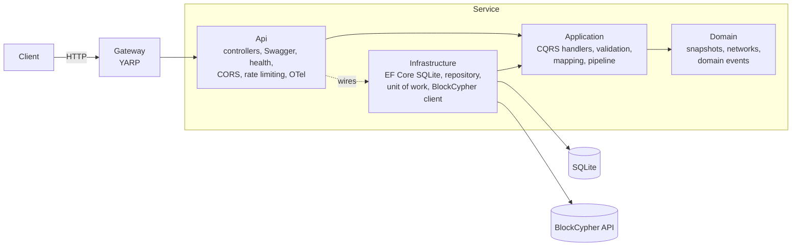

# Blockchain History API

A .NET 10 Web API that captures the current state of five blockchains from [BlockCypher](https://www.blockcypher.com/dev/) and serves each chain's history, **newest first**.

| Chain | Slug | Source |
|---|---|---|
| Ethereum | `eth-main` | https://api.blockcypher.com/v1/eth/main |
| Dash | `dash-main` | https://api.blockcypher.com/v1/dash/main |
| Bitcoin | `btc-main` | https://api.blockcypher.com/v1/btc/main |
| Bitcoin testnet3 | `btc-test3` | https://api.blockcypher.com/v1/btc/test3 |
| Litecoin | `ltc-main` | https://api.blockcypher.com/v1/ltc/main |

Each capture stores BlockCypher's response **exactly as received** (raw JSON), plus typed columns for querying, plus a **`CreatedAt`** timestamp recording when this API captured it.

---

## Quick start

**Prerequisites:** the [.NET 10 SDK](https://dotnet.microsoft.com/download). Docker is optional.

```bash
dotnet run --project src/BlockchainHistory.Api --launch-profile http
```

Open **http://localhost:5080/swagger**, then:
1. `POST /api/v1/blockchains/btc-main/snapshots` to capture Bitcoin now.
2. `POST /api/v1/blockchains/snapshots` to capture all five chains concurrently.
3. `GET /api/v1/blockchains/btc-main/snapshots` to read the history, newest first.

The SQLite database is created and migrated automatically on first start, in `src/BlockchainHistory.Api/data/`.

### Run everything with Docker (Linux containers)

```bash
docker compose up --build
```

| What | URL |
|---|---|
| API gateway (front door) | http://localhost:5000/swagger |
| API (direct) | http://localhost:5080/swagger |
| Telemetry dashboard (traces, metrics, logs) | http://localhost:18888 |

### Runtime profiles

`src/BlockchainHistory.Api/Properties/launchSettings.json` defines three profiles:
- **`http`**: runs on .NET directly, port 5080.
- **`https`**: runs on .NET directly, ports 7080/5080.
- **`Docker`**: runs in a Linux container from Visual Studio.

### Optional configuration

| Setting | Default | Purpose |
|---|---|---|
| `BlockCypher:Token` | *(none)* | BlockCypher API token for a higher quota. **Never commit it**. Use `dotnet user-secrets set "BlockCypher:Token" "<token>" --project src/BlockchainHistory.Api` or the `BlockCypher__Token` environment variable. |
| `Polling:Enabled` / `Polling:IntervalSeconds` | `false` / `300` | Capture every chain on a schedule. |
| `RateLimiting:CapturePermitsPerHour` | `20` | Shared hourly budget for capture endpoints (see design notes). |
| `Cors:AllowedOrigins` | `["http://localhost:3000"]` | Browser origins allowed to call the API. |
| `ConnectionStrings:BlockchainHistory` | `Data Source=data/blockchain-history.db` | SQLite file location. |
| `OTEL_EXPORTER_OTLP_ENDPOINT` | *(unset)* | When set, traces, metrics and logs are exported over OTLP. |

---

## API

| Method | Route | Description | Responses |
|---|---|---|---|
| GET | `/api/v1/blockchains` | Supported chains | 200 |
| POST | `/api/v1/blockchains/{network}/snapshots` | Capture one chain now | 201 + `Location`, 400, 429, 503 |
| POST | `/api/v1/blockchains/snapshots` | Capture all chains concurrently; partial failures are reported, not fatal | 200, 429 |
| GET | `/api/v1/blockchains/{network}/snapshots?page=1&pageSize=20` | History, `CreatedAt` descending | 200, 400 |
| GET | `/api/v1/snapshots/{id}` | One snapshot | 200, 404 |
| GET | `/health/live`, `/health/ready` | Liveness (process) / readiness (database) | 200, 503 |

- `{network}` is a slug from the table above and is case-insensitive.
- Errors are returned as [RFC 9457 Problem Details](https://www.rfc-editor.org/rfc/rfc9457) (`application/problem+json`).

---

## Architecture

Clean Architecture: dependencies point inward, and the compiler enforces it through project references.



| Project | Responsibility | Depends on |
|---|---|---|
| `Domain` | `BlockchainSnapshot` (abstract) → `UtxoChainSnapshot` / `EthereumSnapshot`, network registry, `SnapshotCaptured` event | nothing |
| `Application` | Commands and queries with their handlers, `IBlockCypherClient`, `ISnapshotRepository` and `IUnitOfWork` contracts, validation and logging pipeline, Mapperly mapping, metrics | Domain |
| `Infrastructure` | EF Core `DbContext` (unit of work), repository, migrations, typed BlockCypher `HttpClient` with resilience | Application |
| `Api` | Thin controllers, OpenAPI and Swagger UI, ProblemDetails, health checks, CORS, rate limiting, OpenTelemetry, optional poller | Application, Infrastructure |
| `Gateway` | YARP reverse proxy with routes in configuration, active health checks | (standalone) |

**Flow of `POST /api/v1/blockchains/btc-main/snapshots`:**
1. The controller validates the route automatically (`[ApiController]`) and sends `CaptureSnapshotCommand` through the mediator.
2. The pipeline behaviours run: logging, timing and a trace span, then FluentValidation.
3. The handler fetches from BlockCypher (retry with jitter, timeout, circuit breaker) and creates the domain snapshot with `CreatedAt = TimeProvider.GetUtcNow()`.
4. The repository adds the snapshot and the unit of work commits, **then** publishes `SnapshotCaptured`, which increments a metric and writes a log.
5. The entity is mapped to `SnapshotDto` and the API returns `201 Created`.

---

## Requirements checklist

| Requirement | Where |
|---|---|
| Clean / vertical architecture, SOLID | 4 layered projects. Use cases are vertical slices inside `Application/Snapshots/*` |
| Swagger endpoints showing the history of each chain | `/swagger`. `GET /api/v1/blockchains/{network}/snapshots` |
| Store data with `CreatedAt`, history in `CreatedAt` descending order | `BlockchainSnapshot.CreatedAt`; `SnapshotRepository.GetHistoryAsync`; index `IX_Snapshots_Network_CreatedAt` |
| Health checks route, basic CORS policy | `/health/live`, `/health/ready`; `CorsExtensions` |
| DI, logging, model mapping, serialization, automatic validation | `AddApplication`/`AddInfrastructure`; `[LoggerMessage]` structured logging; Mapperly; System.Text.Json (source-generated for BlockCypher); `[ApiController]` + DataAnnotations, plus FluentValidation in the pipeline |
| Integration, functional and unit test projects | `tests/` (see below) |
| Runtime profiles: .NET and Docker (Linux) | `launchSettings.json`; Dockerfiles; `docker-compose.yml` |
| .NET ≥ 6 | .NET 10 (LTS) |
| Database | SQLite through EF Core, with migrations applied at startup |
| Main data stored as provided in the JSON | `RawJson` column holds the response byte-for-byte, returned as `raw` |
| Performance, inheritance, scalability | Indexed, `AsNoTracking`, paged queries; TPH inheritance; source generators; stateless API behind a gateway |
| Asynchronous / parallel patterns | `async` end to end; `Task.WhenAll` capture-all; `PeriodicTimer` background service |
| At least two design patterns | **CQRS** (Mediator), **Repository**, **Unit of Work**; also Factory, Decorator (pipeline behaviours), Strategy (TPH subtypes), Options |
| Optional: API gateway | `src/BlockchainHistory.Gateway` (YARP) |

---

## Tests

```bash
dotnet test
```

| Project | Scope | Count |
|---|---|---|
| `UnitTests` | Domain rules, handlers, validators and mapper in isolation; NSubstitute doubles and `FakeTimeProvider` | 36 |
| `IntegrationTests` | Our infrastructure against **real** dependencies. A real SQLite database runs the real migration. The real HTTP client and resilience pipeline run against a WireMock server replaying captured BlockCypher responses (retries, 429/503, 404, malformed JSON). | 16 |
| `FunctionalTests` | The whole API over HTTP in memory (`WebApplicationFactory`), with only BlockCypher and the clock replaced. Covers status codes, ordering, paging, validation, ProblemDetails, rate limiting, CORS, health checks, OpenAPI and concurrent captures. | 22 |

CI (`.github/workflows/ci.yml`) builds with warnings as errors, runs all tests, and builds both container images on every push and pull request.

---

## Design decisions and trade-offs

- **`Task.WhenAll`, not PLINQ.**
  - Fetching chains is I/O-bound. `Task.WhenAll` starts all five requests and waits without blocking threads. PLINQ is meant for CPU-bound work and would tie up pool threads waiting on the network.
  - Results are added to the `DbContext` sequentially after the fetches complete, because a `DbContext` is not thread-safe.
- **POST to capture, GET to read.** Reading history never calls BlockCypher, so `GET` stays safe, cacheable and free of side effects.
- **On-demand capture, plus an optional scheduler.** The brief ties `CreatedAt` to requests to our endpoint, so capture is on demand. A real time series would be evenly spaced, so `SnapshotPollingService` can capture on a schedule (off by default).
- **Partial success for capture-all.** One chain failing (for example a BlockCypher 429) does not discard the other four. Failures are reported in the response.
- **Rate limit sized to the upstream quota.** BlockCypher's free tier allows 3 requests a second and 100 an hour. One shared budget of 20 captures an hour (× 5 chains = 100) means we cannot get throttled. Authentication would be the next step.
- **Raw JSON plus typed columns.** The raw JSON is the faithful source of truth and keeps fields we don't model. Typed columns make queries and indexing possible.
- **Inheritance where the model is genuinely an "is-a".** Bitcoin-style chains report fees per kB, while Ethereum reports gas prices. Table-per-hierarchy keeps one table and one query path, with a discriminator column.
- **Repository and Unit of Work over EF Core.** `DbContext` is already a unit of work and repository. The thin, aggregate-specific wrappers exist so the application layer has no EF dependency and is unit-testable. They are deliberately not a generic `IRepository<T>` that leaks `IQueryable`.
- **No Event Sourcing.** Snapshots record an external system's state, not domain events of our own, so there is nothing to source. A domain event (`SnapshotCaptured`) is published after commit for side effects such as metrics.
- **SQLite for zero-setup review.**
  - SQLite allows one writer, so for horizontal scale the API (already stateless) would move to SQL Server or PostgreSQL. That is a provider and connection-string change.
  - Dates are stored as UTC ticks: SQLite cannot sort `DateTimeOffset`, and EF's built-in converter truncates to milliseconds (a test caught this).
- **Libraries.** `Mediator` (source-generated) and Mapperly instead of MediatR and AutoMapper, which became commercial in 2025. They also move work from runtime reflection to compile time.
- **Ids are GUID v7.** They are time-ordered, so inserts append to the index instead of fragmenting it.
- **Gateway for a single service.** It is mostly a demonstration with one service. It pays off with several, because routing, TLS, auth and rate limiting then live in one place. Routes are configuration only.
- **Observability.** OpenTelemetry traces cover HTTP, BlockCypher calls and every mediator message. Metrics cover ASP.NET Core, HttpClient, runtime and `blockchain_history.snapshots.captured`. Logs are structured and source-generated. Everything exports over OTLP, to the Aspire dashboard in compose or to Prometheus/Grafana/Tempo/Loki in production.
- **Bitcoin testnet3 is stale.** testnet3 has been superseded by testnet4, and BlockCypher's `btc/test3` head can lag by hours. It is supported because the brief lists it.

## What I would add for production

- Authentication and authorization (JWT/OIDC) on the capture endpoints, with rate limits per client.
- SQL Server or PostgreSQL, with migrations run by a deployment job instead of at application startup (safe with multiple replicas).
- Caching of recent history (output cache or HybridCache), invalidated by `SnapshotCaptured`.
- Distributed scheduling (a single active poller across replicas), or a message queue for captures.
- Alerting on BlockCypher error rate, circuit-breaker state and capture lag. Kubernetes manifests with liveness and readiness probes.
